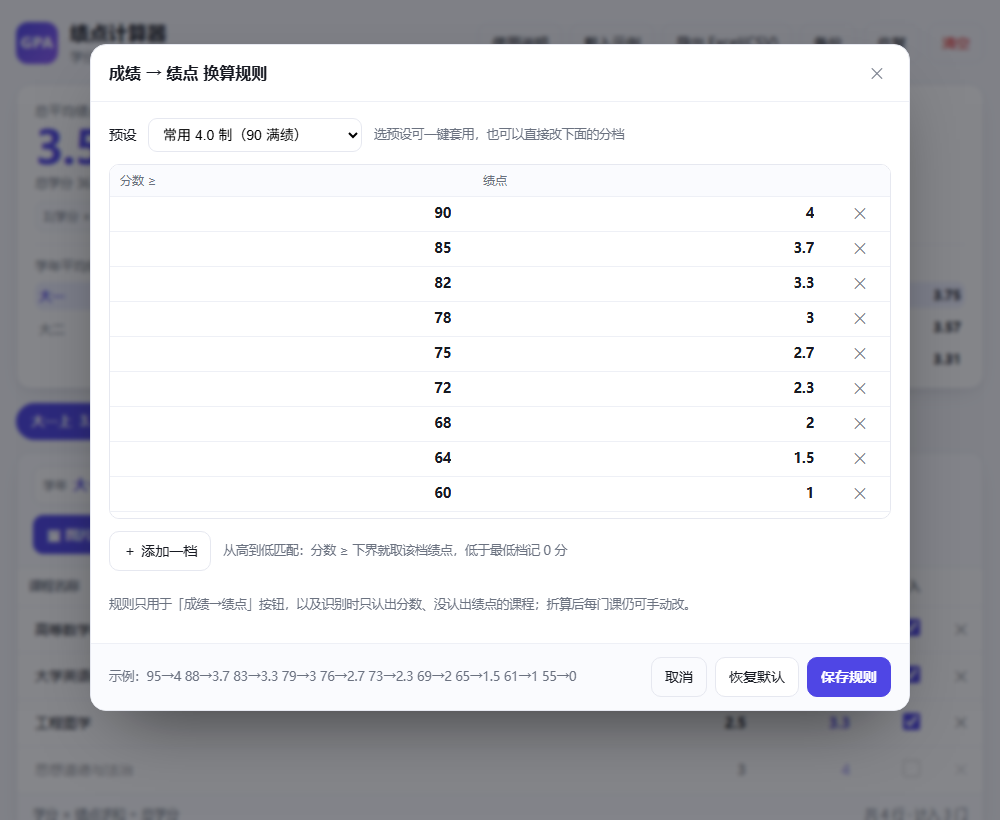

# 绩点计算器 · GPA Calculator

> 一个**单文件**的网页版绩点计算器：不用安装、不用服务器、数据不离开你的浏览器，双击 `index.html` 就能用。
> 支持手动录入，也支持上传成绩单截图自动识别；成绩→绩点的换算规则可按自己学校的规定修改。

**🌐 在线使用：<https://liq-f.github.io/gpa-calculator/>**


---

## 功能

### 三种绩点口径，一次算全

| 口径 | 统计范围 | 说明 |
| --- | --- | --- |
| 学期平均绩点 | 该学期内的课程 | 每张课程表上方实时显示 |
| **学年平均绩点** | 同一学年内的所有学期 | 顶部主位显示，可点击跳转 |
| 总平均绩点 | 全部学期 | 顶部大字显示 |

三者用的是同一个公式：**`Σ(学分 × 绩点) ÷ Σ学分`**（学分加权，不是各学期绩点的简单平均）。

### 灵活的学年划分

每个学期都有独立的「学年」字段，**名字相同的学期自动汇总成一个学年**：

- 默认规则：前两个学期＝大一，第三四个＝大二，以此类推；
- 想按真实学年，把它改成 `2024-2025学年` 这类写法；
- 只想按学年统计、不区分上下学期，那就一个学年只建一个学期；
- 改名后学年绩点立刻重算，顶部学年条点一下即可跳到该学年的第一个学期。

### 课程表：想怎么改就怎么改

- 加行、删行、改课程名、改学分，**绩点任何时候都能手动覆盖**（支持 3.7、4.5 这类小数）；
- 勾掉「计入」即可让某门课不参与任何计算（体育、通识、重修前成绩等）；
- 最后一格按 `Enter` 自动新增一行；
- 从 Excel 复制多行（带制表符）直接粘进表格，会自动拆成多门课。

### 图片识别（OCR）

点「🖼 图片 / 文本导入」→ 拖入或选择成绩单 / 教务系统截图（支持多张）→ 开始识别。


- 识别结果先给你**可编辑的原文**：改完文字点「重新解析」比重识别更快；
- 解析结果先预览，确认后「追加」或「替换」当前学期；
- 导入后所有字段仍可修改，识别没把握的行会**黄底标注**提醒核对；
- 也可以直接把成绩单文字粘贴进原文框解析，完全不联网。

### 成绩 → 绩点：换算规则可自定义

各校算法不一样，所以点「⚙ 换算规则」自己定：



- 内置预设：常用 4.0 制（90 满绩）、简易 4.0 制、严格 4.0 制（85 才满绩）、常用 5.0 制、5.0 制每 10 分一档；
- 也可以直接编辑分档表：每行「分数 ≥ 多少 → 记多少绩点」，可增删任意档，底部实时预览；
- 规则只填**还没有绩点**的课，不影响你手填的值，折完照样能改；
- 规则会被记住，并随备份文件一起导出/恢复。

### 数据属于你自己

- 全部数据存在浏览器 `localStorage`，**不经过任何服务器**（只有 OCR 需要联网下载识别引擎）；
- 支持导出 JSON 备份 / 恢复、导出 CSV（Excel 可直接打开，按学年、学期、总分别给出结果）；
- 响应式布局，手机、平板、电脑都能用，自动适配深色模式。

---

## 快速开始

**直接使用**：打开 <https://liq-f.github.io/gpa-calculator/>，或把 `index.html` 下载到本地双击。

**跑测试**（可选，需要 Node.js 22+ 与本机装有 Chrome / Edge）：

```bash
node tests/unit.js          # 解析与统计逻辑单元测试（纯 Node，秒级）
node tests/integration.js   # 无头浏览器集成测试：模拟真实点击操作
node tests/ocr-e2e.js       # OCR 端到端：生成成绩单图片 → 识别 → 解析 → 导入（需联网）
```

不需要 `npm install`，测试只用 Node 内置模块。

---

## 目录结构

```
.
├── index.html            # 应用本体（HTML + CSS + JS 全在这一个文件里，无外部依赖）
├── tests/
│   ├── lib.js            # 测试公共库：定位本机浏览器 + 极简 CDP 客户端
│   ├── unit.js           # 从 index.html 抽出解析模块做单元测试
│   ├── integration.js    # 注入测试脚本，用无头浏览器跑真实交互
│   └── ocr-e2e.js        # OCR 全链路测试
├── assets/               # README 截图
├── package.json          # 只有 test 脚本，无依赖
└── LICENSE
```

## 技术实现

- **纯静态单文件**：原生 HTML / CSS / JavaScript，没有框架、没有构建步骤、没有后端；
- **OCR**：按需从 CDN 加载 [tesseract.js](https://github.com/naptha/tesseract.js) 5.1.1（`chi_sim` + `eng`），识别前做灰度 + 对比度增强 + 放大预处理；
- **文本解析**：按行提取尾部数字串，再按「成绩 45~100 / 绩点 0~5 / 学分 0.5~10」的取值区间判定列含义，能处理全角数字、序号、课程性质后缀、五级制（优/良/中/及格）等情况；OCR 常把中文识别成「高 等 数学」，会做汉字间空格的还原；
- **持久化**：`localStorage` 自动保存（防抖 250ms）。

## 已知限制

- OCR 是机器识别，**一定会有误差**，分数和小数点最容易错，导入后请对着原图核对一遍；
- 首次使用图片识别需要联网下载语言包（几 MB，之后浏览器会缓存，可离线再用）；网络慢时可能等上一两分钟，界面上有进度提示；
- 数据存在当前浏览器里，换浏览器 / 清理浏览器数据会丢，建议偶尔用「备份」导出 JSON；
- 计算结果仅供参考，请以学校教务系统为准。

## 许可

[MIT](LICENSE) © 2026 liq-f
